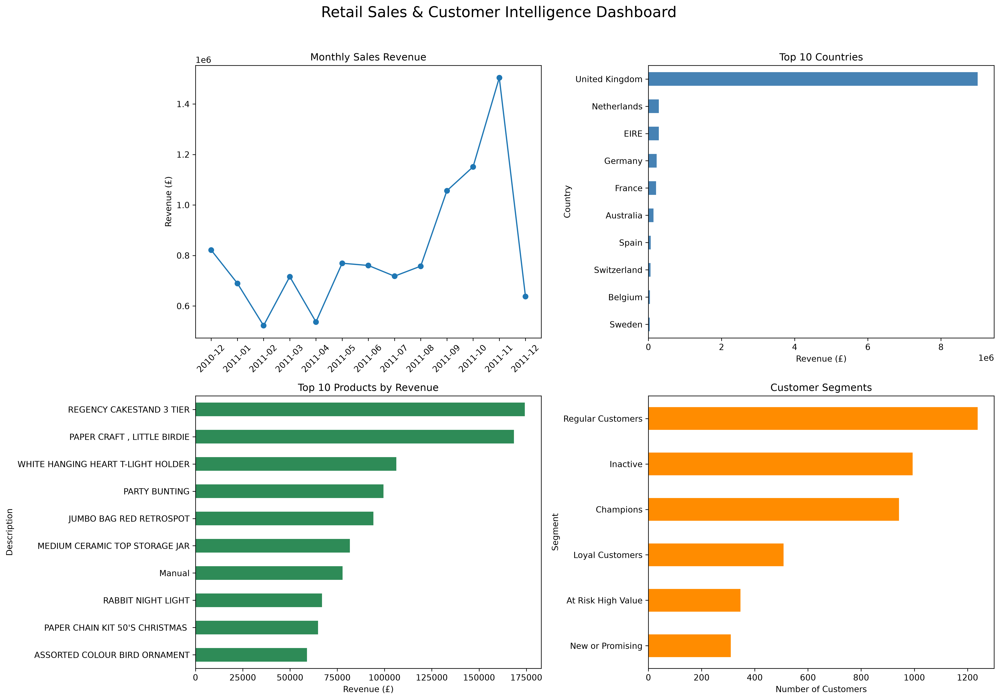

# Retail Sales & Customer Intelligence

### End-to-End Data Analytics Portfolio Project

A retail data analytics project using Python, Pandas,
Matplotlib, and SQL to understand sales performance,
customer purchasing behaviour, and business opportunities.

## Project Overview

This project analyses the UCI Online Retail dataset,
containing 541,909 transaction records.

The goal is to answer important business questions:

- How much revenue does the business generate?
- Which months have the highest sales?
- Which countries contribute the most revenue?
- What are the best-performing products?
- How frequently do customers purchase?
- Which customers are valuable or at risk?

## Technologies Used

- Python 3
- Pandas
- NumPy
- Matplotlib
- SQLite / SQL
- VS Code
- Excel

## Key Performance Indicators

| Metric | Result |
|---|---:|
| Total Revenue | £10,642,110.80 |
| Total Orders | 19,960 |
| Identified Customers | 4,338 |
| Average Order Value | £533.17 |
| Repeat Customer Rate | 65.58% |

## Executive Dashboard



The dashboard includes:

1. Monthly revenue trends
2. Top 10 countries by revenue
3. Top 10 products by revenue
4. Customer segmentation

## Customer Segmentation Using RFM

RFM stands for:

- Recency: Days since the last purchase
- Frequency: Number of unique orders
- Monetary: Total customer spending

Customers are assigned scores from 1 to 5
for each metric.

### Segmentation Results

| Customer Segment | Customers |
|---|---:|
| Regular Customers | 1,238 |
| Inactive | 994 |
| Champions | 942 |
| Loyal Customers | 508 |
| At Risk High Value | 346 |
| New or Promising | 310 |

These segments use rule-based RFM scoring
and should be treated as analytical estimates.

## Key Business Findings

### 1. Revenue Performance

Total sales revenue reached £10.64 million.

November 2011 generated the highest monthly
revenue at approximately £1.50 million.

Revenue increased by 30.63% compared with
October 2011.

Note: December 2011 is an incomplete month
in the dataset and should not be compared
directly with full months.

### 2. Country Performance

The United Kingdom contributed the largest
share of total revenue.

### 3. Product Performance

REGENCY CAKESTAND 3 TIER was the highest-revenue
product after excluding postage charges.

An unusually large PAPER CRAFT transaction
was identified and examined separately.

### 4. Customer Behaviour

65.58% of identified customers placed more
than one order.

942 customers were classified as Champions.

346 customers were classified as At Risk
High Value.

## Business Recommendations

1. Plan inventory around seasonal demand.
2. Prioritise high-performing products.
3. Reward Champion customers with loyalty offers.
4. Create re-engagement campaigns for at-risk customers.
5. Investigate unusual large transactions.
6. Track customer segments over time.

## Data Cleaning

The analysis includes:

- Removing 5,268 duplicate rows
- Excluding cancelled transactions
- Excluding nonpositive quantities and prices
- Calculating transaction revenue
- Handling missing CustomerID values
- Investigating unusual transactions

## Project Structure

```text
retail-intelligence/
├── data/
│   ├── raw/
│   └── processed/
├── docs/
│   ├── retail_dashboard.png
│   ├── customer_segments.png
│   └── business_insights.txt
├── lessons/
│   └── 02_real_retail_analysis.py
├── README.md
└── .gitignore
```

## How to Run

Install the required libraries:

```bash
pip install pandas numpy matplotlib openpyxl
```

Download the UCI Online Retail dataset:

https://archive.ics.uci.edu/dataset/352/online+retail

Place `Online Retail.xlsx` inside `data/raw/`.

Run the analysis from the project root:

```bash
python lessons/02_real_retail_analysis.py
```

Generated reports and charts will be saved
inside the project folders.

## Limitations

- Transactions without CustomerID are excluded
  from customer-level analysis.
- RFM scores use approximate quintiles.
- Customers with tied values may receive
  different scores.
- RFM segments are heuristic classifications.
- December 2011 contains incomplete-month data.
- Unusual transactions may influence results.

## Author

Bogadhi Teja Prakash

Data Analytics | Python | SQL | Data Visualization

[LinkedIn](https://www.linkedin.com/in/bogadhi-teja-prakash-8a44aa435/)
