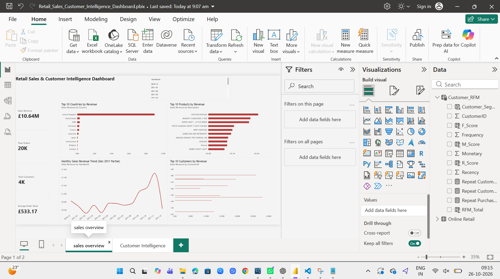
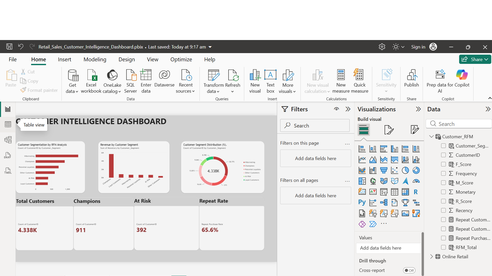

# Retail Sales & Customer Intelligence

### End-to-End Data Analytics Portfolio Project

A retail data analytics project using Python, Pandas,
Matplotlib, and SQL to understand sales performance,
customer purchasing behaviour, and business opportunities.

## Project Overview

This project analyses the UCI Online Retail dataset,
containing 541,909 transaction records.

The goal is to answer important business questions:

- How much revenue does the business generate?
- Which months have the highest sales?
- Which countries contribute the most revenue?
- What are the best-performing products?
- How frequently do customers purchase?
- Which customers are valuable or at risk?

## Technologies Used

* **Python 3** — Data cleaning and analysis
* **Pandas** — Data manipulation and preprocessing
* **NumPy** — Numerical calculations
* **Matplotlib** — Data visualisation
* **SQL / SQLite** — Data querying and analysis
* **Power BI Desktop** — Interactive dashboards and reporting
* **DAX** — KPI calculations and RFM customer segmentation
* **Excel** — Data inspection and validation
* **VS Code** — Python development

## Key Performance Indicators

| Metric | Result |
|---|---:|
| Total Revenue | £10,642,110.80 |
| Total Orders | 19,960 |
| Identified Customers | 4,338 |
| Average Order Value | £533.17 |
| Repeat Customer Rate | 65.58% |

## 🌐 Live Interactive Dashboard

Explore the Retail Sales & Customer Intelligence dashboard
built using Python, Pandas and Streamlit.

### 🚀 [Launch Live Dashboard](https://retailsalescustomerintelligencestarterv2-ggpmnhwprvysz6dbnr7wt.streamlit.app/)

The application provides:
- Sales revenue, orders, customers and average order value
- Monthly sales trends
- Revenue analysis by country
- Top-performing products
- Key business insights

**Dataset:** UCI Online Retail (2010–2011).
Historical data, not live sales.

## Interactive Power BI Dashboards

This project includes two interactive Power BI dashboard pages
for analysing retail sales and customer behaviour.

### 1. Sales Overview



Key features:
- Total Sales Revenue: £10.64M
- Total Orders: 19,960
- Total Customers: 4,338
- Average Order Value: £533.17
- Top 10 countries by revenue
- Top 10 products by revenue
- Monthly sales revenue trends

### 2. Customer Intelligence



Key features:
- RFM customer segmentation
- Champions: 911 customers
- At Risk: 392 customers
- Repeat Purchase Rate: 65.6%
- Revenue contribution by customer segment
- Customer segment distribution
## Customer Segmentation Using RFM

RFM stands for:

- Recency: Days since the last purchase
- Frequency: Number of unique orders
- Monetary: Total customer spending

Customers are assigned scores from 1 to 5
for each metric.

### Segmentation Results

Customer segmentation was performed using RFM analysis
in both Python and Power BI.

#### Python RFM Analysis

| Customer Segment | Customers |
|---|---:|
| Regular Customers | 1,238 |
| Inactive | 994 |
| Champions | 942 |
| Loyal Customers | 508 |
| At Risk High Value | 346 |
| New or Promising | 310 |

#### Power BI RFM Analysis

The Power BI dashboard uses a separate set of
rule-based RFM segmentation criteria.

| Metric | Result |
|---|---:|
| Total Identified Customers | 4,338 |
| Champions | 911 |
| At Risk | 392 |
| Repeat Purchase Rate | 65.6% |

The two analyses use different segmentation rules,
so their segment counts should not be compared directly.

RFM segments are analytical estimates rather than
fixed customer classifications.

## Key Business Findings

### 1. Revenue Performance

Total sales revenue reached £10.64 million.

November 2011 generated the highest monthly
revenue at approximately £1.50 million.

Revenue increased by 30.63% compared with
October 2011.

Note: December 2011 is an incomplete month
in the dataset and should not be compared
directly with full months.

### 2. Country Performance

The United Kingdom contributed the largest
share of total revenue.

### 3. Product Performance

REGENCY CAKESTAND 3 TIER was the highest-revenue
product after excluding postage charges.

An unusually large PAPER CRAFT transaction
was identified and examined separately.

### 4. Customer Behaviour

65.58% of identified customers placed more than one order, indicating a strong proportion of repeat customers.

**Python RFM Analysis:**

* Champions: 942 customers
* At Risk High Value: 346 customers

**Power BI RFM Analysis:**

* Champions: 911 customers
* At Risk: 392 customers

The differences in customer counts reflect the different rule-based RFM segmentation methods used in Python and Power BI.

These insights can help the business identify valuable customers, improve customer retention, and develop targeted marketing strategies.

## Business Recommendations

1. Plan inventory around seasonal demand.
2. Prioritise high-performing products.
3. Reward Champion customers with loyalty offers.
4. Create re-engagement campaigns for at-risk customers.
5. Investigate unusual large transactions.
6. Track customer segments over time.

## Data Cleaning

The analysis includes:

- Removing 5,268 duplicate rows
- Excluding cancelled transactions
- Excluding nonpositive quantities and prices
- Calculating transaction revenue
- Handling missing CustomerID values
- Investigating unusual transactions

## Project Structure

retail-intelligence/
│
├── data/
│   ├── raw/
│   └── processed/
│
├── docs/
│   ├── retail_dashboard.png
│   ├── customer_segments.png
│   ├── top_10_products.png
│   ├── monthly_sales_trend.png
│   ├── top_10_countries.png
│   ├── powerbi_sales_overview.png
│   ├── powerbi_customer_intelligence.png
│   └── business_insights.txt
│
├── lessons/
│   └── 02_real_retail_analysis.py
│
├── retail/
│
├── Retail_Sales_Customer_Intelligence_Dashboard.pbix
├── app.py
├── requirements.txt
├── run_project.ps1
├── README.md
└── .gitignore

## How to Run

Install the required libraries:

```bash
pip install pandas numpy matplotlib openpyxl
```

Download the UCI Online Retail dataset:

https://archive.ics.uci.edu/dataset/352/online+retail

Place `Online Retail.xlsx` inside `data/raw/`.

Run the analysis from the project root:

```bash
python lessons/02_real_retail_analysis.py
```

Generated reports and charts will be saved
inside the project folders.

## Limitations

- Transactions without CustomerID are excluded
  from customer-level analysis.
- RFM scores use approximate quintiles.
- Customers with tied values may receive
  different scores.
- RFM segments are heuristic classifications.
- December 2011 contains incomplete-month data.
- Unusual transactions may influence results.

## Author

Bogadhi Teja Prakash

Data Analytics | Python | SQL | Data Visualization

[LinkedIn](https://www.linkedin.com/in/bogadhi-teja-prakash-8a44aa435/)
